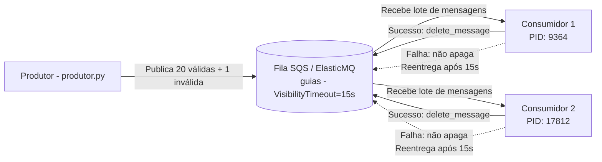

# Mensageria com Amazon SQS e ElasticMQ

Implementação de comunicação assíncrona com fila compatível com Amazon SQS (utilizando ElasticMQ via Docker), com publicação de mensagens por produtor e consumo concorrente por múltiplos consumidores.

---

## 1. Visão Geral da Arquitetura

O sistema implementa o padrão de comunicação assíncrona baseado em mensageria para a emissão de guias de transporte do **Rota Vital**:
- **Fila (`guias`):** Fila Standard hospedada no **ElasticMQ** (Docker), compatível com a API do AWS SQS, configurada com `VisibilityTimeout = 15s`.
- **Produtor (`produtor.py`):** Publica em lote 21 mensagens (20 pedidos válidos `R-001` a `R-020` do hospital `H-Recife` e 1 pedido inválido sem o campo `requisicaoId`).
- **Consumidores (`consumidor.py`):** Processam as mensagens concorrentemente, exibem o PID do processo em execução, geram a guia correspondente e invocam a exclusão explícita (`delete_message`). Em caso de falha, a mensagem não é apagada e retorna para a fila após expirar o `VisibilityTimeout`.



---

## 2. Estrutura do Repositório

```text
├── docker-compose.yml          # Definição do serviço ElasticMQ
├── requirements.txt            # Dependências Python (boto3)
├── criar_fila.py               # Script para criação automatizada da fila com VisibilityTimeout=15s
├── consumidor.py               # Worker que lê mensagens, processa guias e realiza confirmação (ACK)
├── produtor.py                 # Publicador de 20 pedidos válidos e 1 inválido
├── README.md                   # Documentação completa, instruções, respostas e declaração de IA
└── evidencias/                 # Evidências de execução e logs dos testes
    ├── elasticmq_docker.txt    # Log do container ElasticMQ inicializado
    ├── criacao_fila.txt        # Atributos e confirmação da fila criada
    ├── cenario1_1consumidor.txt# Execução com 1 consumidor e 1 produtor (reentregas)
    └── cenario2_2consumidores.txt# Execução com 2 consumidores (divisão de carga e PID)
```

---

## 3. Instruções de Reprodução (Como Rodar)

### 3.1. Pré-requisitos
- **Docker Desktop** instalado e em execução.
- **Python 3.12+** instalado.
- Dependência `boto3`:
  ```bash
  pip install -r requirements.txt
  ```

---

### 3.2. Passo 1: Subir o Servidor ElasticMQ (SQS Local)

Você pode subir via Docker Compose ou com o comando Docker direto:

**Opção A (Docker Compose):**
```bash
docker compose up -d
```

**Opção B (Docker Run):**
```bash
docker run -d --name elasticmq-sqs -p 9324:9324 softwaremill/elasticmq-native
```

> **Verificação:** Para conferir se o serviço está ativo na porta `9324`:
> ```bash
> docker logs elasticmq-sqs
> ```

---

### 3.3. Passo 2: Criar a Fila com `VisibilityTimeout = 15s`

A fila pode ser criada via script Python auxiliar (`criar_fila.py`) ou via AWS CLI:

**Via Python (Multiplataforma):**
```bash
python criar_fila.py
```

**Ou via AWS CLI (caso tenha instalado):**
```bash
# No Windows PowerShell:
$env:AWS_ACCESS_KEY_ID="x"; $env:AWS_SECRET_ACCESS_KEY="x"; $env:AWS_DEFAULT_REGION="us-east-1"
aws sqs create-queue --queue-name guias --attributes VisibilityTimeout=15 --endpoint-url http://localhost:9324
```

---

### 3.4. Passo 3: Executar os Cenários de Teste

#### **Cenário 1: 1 Consumidor e 1 Produtor**
1. Em um terminal, inicie o consumidor:
   ```bash
   python consumidor.py
   ```
2. Em outro terminal, execute o produtor:
   ```bash
   python produtor.py
   ```
3. **Observação esperada:** O consumidor gerará as 20 guias (`G-R-001` a `G-R-020`) e processará a mensagem inválida. Como ela lança exceção e não é apagada, após cada ciclo de 15 segundos ela reaparece no log com o `ApproximateReceiveCount` aumentando (`1`, `2`, `3`...).

#### **Cenário 2: 2 Consumidores Simultâneos (Divisão de Carga)**
1. Pare os processos anteriores (Ctrl+C).
2. Abra **dois terminais distintos** e execute em cada um:
   - **Terminal 1:** `python consumidor.py` (anote o PID exibido)
   - **Terminal 2:** `python consumidor.py` (anote o PID exibido)
3. No terceiro terminal, execute o produtor:
   ```bash
   python produtor.py
   ```
4. **Observação esperada:** As 20 mensagens serão balanceadas entre os dois PIDs. A mensagem com erro falhará em um consumidor e, após o `VisibilityTimeout` de 15 segundos, será puxada pelo outro consumidor, demonstrando concorrência e reentrega.

---

## 4. Evidências dos Testes Práticos

### 4.1. Cenário 1: Confirmação e Reentrega por Timeout (1 Consumidor)
Log registrado em `evidencias/cenario1_1consumidor.txt`:
```text
Consumidor iniciado (PID: 15524). Aguardando mensagens...
15524 guia G-R-001 H-Recife
15524 guia G-R-002 H-Recife
...
15524 guia G-R-020 H-Recife
falhou; volta para a fila: mensagem sem requisicaoId {'ApproximateReceiveCount': '1'}
falhou; volta para a fila: mensagem sem requisicaoId {'ApproximateReceiveCount': '2'}
falhou; volta para a fila: mensagem sem requisicaoId {'ApproximateReceiveCount': '3'}
falhou; volta para a fila: mensagem sem requisicaoId {'ApproximateReceiveCount': '4'}
```
*Análise:* As 20 mensagens com ID foram processadas e confirmadas (`delete_message`), não retornando mais à fila. A mensagem sem `requisicaoId` falhou, não recebeu ACK de exclusão e, pontualmente a cada 15 segundos, retornou à fila com o contador de recebimento incrementado.

---

### 4.2. Cenário 2: Dois Consumidores Concorrentes (Divisão do Trabalho)
Log registrado em `evidencias/cenario2_2consumidores.txt`:
```text
[CONSUMIDOR 1] Consumidor iniciado (PID: 9364). Aguardando mensagens...
[CONSUMIDOR 2] Consumidor iniciado (PID: 17812). Aguardando mensagens...

[CONSUMIDOR 1] 9364 guia G-R-001 H-Recife
[CONSUMIDOR 2] 17812 guia G-R-002 H-Recife
[CONSUMIDOR 1] 9364 guia G-R-003 H-Recife
[CONSUMIDOR 2] 17812 guia G-R-004 H-Recife
[CONSUMIDOR 1] 9364 guia G-R-005 H-Recife
[CONSUMIDOR 2] 17812 guia G-R-006 H-Recife
...
[CONSUMIDOR 1] 9364 guia G-R-019 H-Recife
[CONSUMIDOR 2] 17812 guia G-R-020 H-Recife

[CONSUMIDOR 1] falhou; volta para a fila: mensagem sem requisicaoId {'ApproximateReceiveCount': '1'}
[CONSUMIDOR 2] falhou; volta para a fila: mensagem sem requisicaoId {'ApproximateReceiveCount': '2'}
[CONSUMIDOR 1] falhou; volta para a fila: mensagem sem requisicaoId {'ApproximateReceiveCount': '3'}
```
*Análise:*
- **Divisão do trabalho:** Cada consumidor processou 10 guias de forma concorrente e intercalada (PID 9364 atendeu os ímpares e PID 17812 atendeu os pares).
- **Reentrega alternada:** A mensagem com erro falhou na 1ª tentativa no Consumidor 1 (PID 9364). Passados os 15s de visibilidade, ela foi recebida pelo Consumidor 2 (PID 17812 com receive count 2), e depois voltou para o Consumidor 1 (receive count 3).

---

## 5. Respostas às Perguntas do Roteiro

### 1. Por que o consumidor só apaga a mensagem depois de processar? O que aconteceria se apagasse antes?
**Resposta:**  
O consumidor só apaga a mensagem (`sqs.delete_message`) após o processamento completo porque o Amazon SQS adota o modelo de confirmação explícita (ACK) para garantir entrega confiável (*at-least-once delivery*). 

Quando uma mensagem é lida por um consumidor, o SQS não a remove da fila; ele apenas a torna temporariamente invisível para os outros consumidores durante o período de `VisibilityTimeout`. 

Se o consumidor apagasse a mensagem **antes** de processá-la e ocorresse uma falha crítica no meio do caminho (por exemplo: pane no hardware, queda do container, queda de energia, estouro de memória ou uma exceção de validação), **a mensagem seria perdida para sempre** (*data loss*). O trabalho não seria concluído e nenhum outro consumidor saberia que ela existiu. Ao apagar somente no fim, garante-se que, caso o consumidor morra ou falhe, a mensagem voltará automaticamente à visibilidade da fila para que outro consumidor saudável possa processá-la.

---

### 2. Com dois consumidores, como as mensagens se dividiram? A ordem foi mantida? O que a documentação do SQS diz sobre ordem nas filas padrão?
**Resposta:**  
- **Como se dividiram:** As mensagens foram divididas de maneira equilibrada e concorrente entre as duas instâncias. Nos testes práticos, cada consumidor processou 10 mensagens das 20 publicadas, alternando requisições conforme o modelo de *Competing Consumers*.
- **A ordem foi mantida?** No teste com baixo volume e ambiente local, as mensagens foram processadas em ordem majoritariamente sequencial (`R-001`, `R-002`, `R-003`...), porém intercaladas entre os dois PIDs. No entanto, **não há garantia estrita de preservação da ordem**.
- **O que a documentação oficial do SQS diz:** As filas padrão (**Standard Queues**) oferecem garantia de **ordenação de melhor esforço (*best-effort ordering*)**. Isso significa que a AWS tenta entregar as mensagens na ordem de postagem, mas fatores como alta concorrência de múltiplos servidores distribuídos, latência de rede e reentregas por timeout podem fazer com que mensagens cheguem fora da ordem de envio original. Caso uma aplicação exija garantia absoluta e estrita de ordem FIFO (*First-In-First-Out*) e deduplicação exata, a AWS estabelece que deve ser utilizada uma **FIFO Queue** (filas com sufixo `.fifo`).

---

### 3. A fila padrão garante entrega pelo menos uma vez, e a mesma mensagem pode chegar duas vezes. O que isso exige do consumidor? Como vocês o tornariam idempotente?
**Resposta:**  
- **O que isso exige do consumidor:** Exige que a lógica de negócio do consumidor seja **idempotente**. Uma operação é idempotente quando executá-la uma única vez ou múltiplas vezes com a mesma entrada produz exatamente o mesmo resultado no estado do sistema, sem gerar efeitos colaterais duplicados (como gerar duas guias de transporte idênticas, cobrar o cliente em duplicidade ou criar registros redundantes no banco).
- **Como torná-lo idempotente na prática:**
  1. **Chave de Unicidade no Banco de Dados (Constraint UNIQUE):** Utilizar o identificador de negócio (`requisicaoId`) como chave primária ou índice único na tabela de guias emitidas. Se uma mensagem repetida chegar, o comando `INSERT` falhará por violação de unicidade ou executará um `ON CONFLICT DO NOTHING`, evitando a criação de duplicatas.
  2. **Tabela de Controle de Mensagens Processadas (Inbox Pattern / Deduplication Store):** Antes de iniciar qualquer efeito colateral (gravação ou chamada a APIs externas), o consumidor verifica em uma tabela ou em um cache rápido (como Redis) se o `requisicaoId` já foi marcado com status `CONCLUIDO`. Caso já tenha sido processado, o consumidor simplesmente ignora o processamento e executa o `delete_message` para remover a duplicata da fila.

---

### 4. Expliquem o visibility timeout com o que viram na mensagem inválida. Para que serve uma DLQ?
**Resposta:**  
- **Explicação do Visibility Timeout com o experimento:** O *Visibility Timeout* é o intervalo em que uma mensagem já entregue a um consumidor permanece oculta para os demais consumidores da fila, dando a ele tempo hábil para executar o processamento. No nosso experimento com timeout de 15 segundos, a mensagem sem `requisicaoId` gerou um erro no método `processar()` e, portanto, **não chegou a executar o `delete_message`**. Durante 15 segundos ela ficou invisível na fila. Assim que o cronômetro de 15 segundos expirou, o ElasticMQ tornou a mensagem visível de novo. No próximo ciclo de polling, um dos consumidores a retirou novamente, o que pôde ser comprovado pela repetição da mensagem com o `ApproximateReceiveCount` incrementando (`1`, `2`, `3`, `4`...).
- **Para que serve uma DLQ (Dead Letter Queue):** Sem uma DLQ, mensagens com defeito irreparável (chamadas de *poison pills*, como dados fora de formato ou IDs inexistentes) ficam em um loop eterno de falha e reentrega, consumindo processamento, recursos de rede e poluindo os registros de log. A **DLQ (Fila de Mensagens Mortas)** serve para isolar automaticamente mensagens que excederam um número máximo de tentativas configurado (`maxReceiveCount`, ex: 3 tentativas). Ao ser movida para a DLQ, a mensagem problemática deixa de travar a fila principal e fica armazenada para inspeção manual, alertas de monitoramento e auditoria pela equipe de suporte/engenharia.

---

### 5. No Rota Vital, qual a diferença entre o hospital chamar a emissão de guia diretamente (síncrono) e passar por uma fila (assíncrono)? O que se ganha e o que se perde?
**Resposta:**  

| Critério | Chamada Direta Síncrona (ex: HTTP/REST) | Passar por Fila Assíncrona (SQS / Mensageria) |
| :--- | :--- | :--- |
| **Funcionamento** | O sistema do hospital faz a requisição e fica travado esperando a geração completa da guia para receber a resposta. | O hospital posta a solicitação na fila (em milissegundos), recebe confirmação de recebimento imediata e a guia é processada em segundo plano pelos consumidores. |
| **O que se Ganha (Vantagens)** | **Imediatismo:** O hospital recebe a guia pronta e o status final instantaneamente na mesma conexão HTTP. Simplicidade inicial de arquitetura. | **1. Resiliência e Desacoplamento:** Se o serviço emissor de guias cair ou entrar em manutenção, o hospital não recebe erro; os pedidos ficam enfileirados com segurança.<br>**2. Nivelamento de Picos de Carga (*Load Leveling*):** Picos de requisições hospitalares não derrubam o backend nem sobrecarregam o banco de dados; a fila atua como buffer.<br>**3. Escalabilidade Elástica:** Pode-se subir múltiplos consumidores em horários de pico para esvaziar a fila com rapidez. |
| **O que se Perde (Trade-offs)** | **Fragilidade e Acoplamento Temporal:** Se o serviço de guias estiver lento ou fora do ar, o sistema do hospital trava e a requisição falha (*timeout*). Vulnerabilidade a quedas em horários de pico. | **1. Imediatismo de Resposta:** O hospital não recebe a guia de volta no mesmo segundo; precisa consultar o status posteriormente (consistência eventual, Webhooks ou polling).<br>**2. Complexidade Operacional:** Necessidade de gerenciar idempotência, dead letter queues e monitorar a infraestrutura de filas. |

---

## 6. Seção: Uso de Inteligência Artificial (PO-CESAR-021)

Em conformidade com as diretrizes da política institucional do CESAR School (PO-CESAR-021):

- **Ferramenta utilizada:** Antigravity (Google DeepMind - Claude 3.8 / Gemini).
- **Finalidade do uso:** 
  1. Apoio na automação e estruturação dos scripts Python utilizando o SDK `boto3`.
  2. Apoio na formatação e validação dos scripts de teste concorrente para captura limpa de evidências em arquivos de log.
  3. Estruturação didática e revisão técnica das respostas conceituais sobre o Amazon SQS e padrões de mensageria assíncrona.
- **Validação humana:**
  - Todos os códigos foram executados, depurados e testados localmente no ambiente Docker e Python do autor.
  - As saídas e evidências foram inspecionadas e validadas diretamente contra o comportamento real do ElasticMQ (portas, status da fila e incremento de `ApproximateReceiveCount`).
  - As respostas teóricas foram verificadas em conformidade com as aulas ministradas (Aulas 006 e 007) e a documentação oficial da AWS (*Amazon SQS Developer Guide*).

